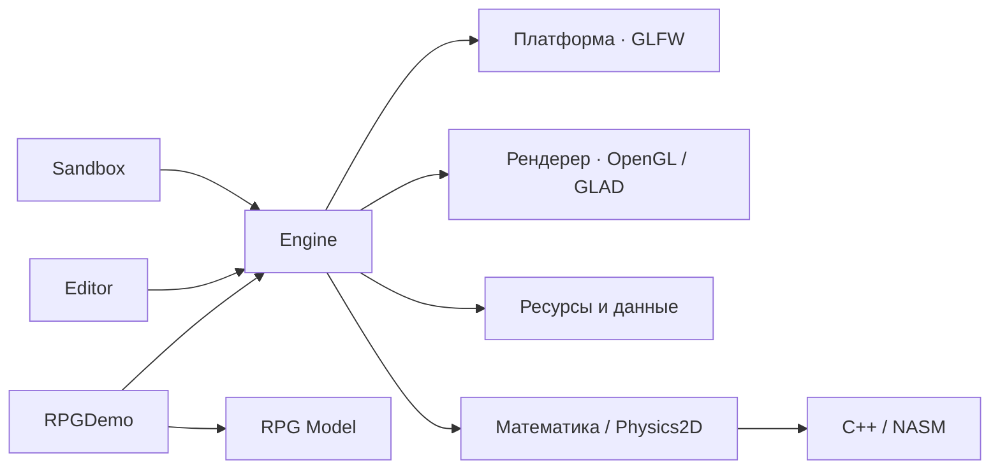

# Архитектура Game Framework 2D

Движок отвечает за окно и цикл приложения, рендеринг, ввод, объекты, ресурсы и инструменты разработки. Игра задаёт правила, экраны и контент. Первой проверкой архитектуры служат существующие игры Signal Below и The Vault. В дальнейшем отдельный RPGDemo должен показать игровой цикл от выбора команды до сохранения результатов экспедиции.

## Точка отсчёта

В исходном прототипе уже есть фиксированный шаг симуляции 120 Гц, ввод с клавиатуры и мыши, спрайты и слои, интерполяция положения, мир объектов, столкновения с AABB и ядро фильтрации на MASM. Существующие сцены, команды проверки и сборка через `game_framework.slnx` дают контрольную реализацию. Первый этап вводит сборку на CMake и новое платформенное основание, сохраняя игровой API и поведение демонстраций.

## Приложения и зависимости



| Уровень | Ответственность | Целевая граница API |
| --- | --- | --- |
| **Engine** | Статическая C++-библиотека с общими подсистемами | Приложения подключают типы `gf::Application`, `gf::Scene`, `gf::Input`, `gf::World` и 2D-команды отрисовки. Типы GLFW, GLAD и дескрипторы GL остаются внутри реализации. |
| **Sandbox** | Исполняемый пример, тестовые сцены и графические проверки | Выбирает и запускает сцены через публичный API. Здесь остаются существующие демонстрации. |
| **Editor** | Отдельное приложение для правки сцен и ресурсов с предпросмотром через framebuffer | Использует те же компоненты и форматы данных, что и Sandbox, и запускает предпросмотр через публичные интерфейсы Engine. |
| **RPGDemo** | Отдельное приложение с боем, подземельем, поселением и сохранениями | Модуль правил RPG Model моделирует бой, инвентарь и кампанию в обычном C++. Представление переводит ввод в команды, а события модели в анимацию, UI и звук. |

Editor и RPGDemo появляются по мере прохождения этапов. Целевая библиотека Engine освобождает игры от прямого управления окном и графическим контекстом.

## Границы подсистем

| Подсистема | Контракт |
| --- | --- |
| **Core и Platform** | `Application` владеет окном, рендерером и текущей сценой. Окно собирает события ОС и обновляет ввод. Цикл выполняет фиксированные шаги, рисует интерполированный кадр и измеряет FPS и время кадра. Логирование обслуживает консоль и файл. |
| **Events** | Подписки привязаны ко времени жизни владельца и снимаются через RAII. Отложенные события хранят данные по значению и обрабатываются в явной точке кадра. |
| **Rendering** | Публичные команды принимают спрайты, камеру, слои и параметры материала. Backend строит пакеты в порядке рисования, владеет VAO/VBO/EBO, текстурами, шейдерами и framebuffer. Профиль 3.3 обслуживает базовые операции. Возможности 4.x проверяются по фактическому контексту и расширениям. |
| **Scene, ECS и Physics2D** | Сцена владеет реестром объектов и настройками. Игровые системы работают с компонентами через проверяемые идентификаторы и применяют структурные изменения в определённых точках обновления. Физика предоставляет геометрические запросы и простое перемещение. |
| **Animation** | Клип содержит ключевые кадры, длительности и метки событий. Контроллер вычисляет состояние и обновляет компоненты представления. Скелетная анимация развивает ту же модель времени и событий. |
| **Assets и Serialization** | Менеджер ресурсов разрешает пути от корня проекта, кэширует по идентификатору и управляет временем жизни. Асинхронная подготовка допустима для CPU-данных. GPU-объекты создаются и удаляются при активном контексте. Сцены, шаблоны и прогресс имеют раздельные JSON-схемы с версиями. Для ссылок применяются стабильные идентификаторы. |
| **UI и Audio** | Игровой UI обрабатывает фокус, порядок слоёв и потребление ввода. Аудиосистема воспроизводит команды с учётом группы и громкости. Инструменты на Dear ImGui используют общий рендерер и диагностику. |
| **Debug, Profiling и Assembly** | Метрики разделяют время кадра, время CPU и GPU при наличии таймеров. SIMD-ядра вызываются через узкие C ABI-границы. Эталонные функции C++ сравниваются с NASM на одинаковых данных. |

Владение ресурсами следует времени жизни подсистем. Сцена освобождает свои ресурсы до разрушения рендерера. Рендерер освобождает GPU-объекты при текущем контексте, затем уничтожается окно. Входные события сохраняются до потребления фиксированным шагом, состояние удержания сбрасывается при потере фокуса.

## Выбор библиотек

| Инструмент | Причина выбора | Когда подключается |
| --- | --- | --- |
| **GLFW** | Окно, ввод, контекст и VSync через одно API для Windows и будущего Linux. GLFW обслуживает платформенный код. [GLFW Context Guide](https://www.glfw.org/docs/3.5/context_guide.html) | 1 |
| **GLAD 2** | Типизированная загрузка функций современного OpenGL. Символы загружаются после активации созданного GLFW контекста через `glfwGetProcAddress`. [GLAD](https://github.com/Dav1dde/glad/tree/glad2) | 1 |
| **CMake и CTest** | Цели библиотеки, приложений и тестов в одной сборке. Версии зависимостей фиксируются в сборочной конфигурации или в исходниках поставляемой зависимости. [CMake FetchContent](https://cmake.org/cmake/help/latest/module/FetchContent.html) | 1 |
| **GLM** | Векторы и матрицы для камеры и преобразований 2D. `Rect` и геометрические запросы остаются предметными типами Engine. | 2 |
| **stb_image / WIC** | WIC уже обслуживает PNG в Windows-прототипе. Переносимый декодер на stb_image можно подключить за тем же API при развитии системы текстур. | Прототип / 2–3 |
| **nlohmann/json** | Чтение и запись версионированных JSON-документов, валидация значений выполняется на уровне схем движка. | 4 |
| **FreeType и miniaudio** | Растеризация шрифтов для Unicode и звуковые потоки с группами громкости. | 6 |
| **Dear ImGui** | Инструментальные окна редактора, инспектор и профилировщик. | 7 |
| **NASM** | Отдельные объектные файлы x86-64 и явная граница C ABI. Фильтрация AABB перенесена на NASM в рамках сборки первого этапа. При отсутствии NASM работает версия C++. | 1 для AABB, 12 для остальных ядер |

Для ECS планируется развитие текущего реестра объектов с типизированными хранилищами компонентов. Выбор подтверждается проверками удаления во время обновления, а также измерениями создания, удаления и перебора тысяч объектов. Сцены сохраняют независимые идентификаторы для ссылок между сущностями и для восстановления из файла.

## Каталоги

Физическая структура наращивается по этапам. Для первого этапа сохраняются имена каталогов прототипа, чтобы исходники обеих демонстраций и существующее решение оставались на своих местах.

```text
game_framework/
  game_framework.slnx       исходное решение Visual Studio 2026
  game_framework/
    CMakeLists.txt          цели Engine, Sandbox и проверки первого этапа
    CMakePresets.json       Visual Studio 2022 и 2026, Debug и Release
    game_framework.cpp     точка входа Sandbox
    engine/                публичные заголовки и реализация прототипа
    demo/                  существующие сцены Sandbox
    ThirdParty/            фиксированные версии GLFW и GLAD
    Docs/Architecture.md   архитектура и критерии этапов
    README.md              команды сборки и запуска
```

По мере роста публичные заголовки и внутренние реализации Engine получают отдельные каталоги. `Editor/` и `RPGDemo/` добавляются вместе с исполняемыми целями, `Tests/` и `Benchmarks/` растут вместе с проверками, `Assembly/` содержит NASM-ядра, а `Shaders/` появляется при выносе GLSL в отдельные ресурсы.

### Приёмка первого этапа

- Сборка из чистого каталога создаёт статическую библиотеку Engine и отдельный Sandbox в конфигурациях Debug и Release для Windows x64.
- Приложение показывает сцену и FPS. Изменение размера окна сохраняет пропорции холста и правильное положение курсора. Демонстрации переключаются и закрываются штатно.
- Графическая проверка создаёт Core Profile, проверяет загрузку GLAD и результат отрисовки, затем освобождает ресурсы контекста. В лог выводятся версия контекста и сведения о драйвере.
- Тесты симуляции, ввода и правил демонстрационных сцен проходят без OpenGL. Проверка регрессий включает прохождение платформера, пошаговый бой и библиотеку вычислений AABB.

## Очерёдность реализации

Этап закрывается сборкой и проверкой результата из правой колонки. Оценка для одного разработчика ориентировочная и включает проверку и документацию.

| Этап | Объём | Проверяемый результат |
| --- | --- | --- |
| 1. Минимальное ядро · до 1 недели | CMake, Engine и Sandbox, GLFW, GLAD, окно, ввод, цикл, логирование, VSync и FPS | Sandbox открывает окно Core Profile, показывает FPS, принимает ввод и штатно закрывается. CTest подтверждает логику и проверку графики на системе с драйвером. |
| 2. Renderer2D · 1–2 недели | Шейдеры и геометрия VAO/VBO/EBO, текстуры, спрайты, камера и масштабирование viewport | Текстурированные объекты видны при управлении камерой и изменении размера окна. |
| 3. Пакетный рендеринг · 1–2 недели | Несколько текстур в пакете, атласы, слои, параллакс, framebuffer и счётчики | Одна и та же сцена со множеством спрайтов воспроизводит порядок альфа-смешивания. Есть замеры draw calls и времени кадра. |
| 4. ECS и сцены · 1–2 недели | Динамические компоненты, жизненный цикл сцен, prefab, ресурсы и JSON | Новая сцена с несколькими экземплярами prefab загружается из файла, а данные проходят проверку сохранения и повторного чтения. |
| 5. Анимация · 2–3 недели | Клипы, контроллер, события, иерархия костей и базовое смешивание | Спрайтовый и скелетный персонажи переключают состояния, события срабатывают независимо от FPS. |
| 6. UI и звук · 2–3 недели | Текст и кириллица, UI-компоненты, фокус, биндинги и аудио | Экран управляется клавиатурой и мышью, показывает текст и воспроизводит музыку и эффекты. |
| 7. Редактор · 2–3 недели | Dear ImGui, дерево, инспектор, viewport, браузер ресурсов и сериализация | Сцена, сделанная в редакторе, открывается в Sandbox из файла. |
| 8. Пошаговый бой · 2–3 недели | Характеристики, позиции четырёх героев, очередь, выбор целей, эффекты и AI | Играбельный бой с победой и поражением. Тесты правил работают без окна. |
| 9. Подземелье · 1–2 недели | Генерация графа по seed, исследование, события, бои и награды | Экспедиция проходима от входа до выхода, достижимость проверяется тестом. |
| 10. Кампания · 2–3 недели | Поселение, команда, инвентарь, экипировка, развитие и прогресс | Подготовка, экспедиция, награды и возвращение связаны в один цикл. Прогресс восстанавливается после перезапуска. |
| 11. Графическая полировка · 1–2 недели | Свет, эффекты framebuffer, частицы, анимации и переходы | Вертикальный срез оформлен оригинальными ресурсами, тяжёлые эффекты можно отключить. |
| 12. Assembly и оптимизация · 1–2 недели | NASM/SSE2, выбор реализации на CPU, C++ fallback, тесты ABI и микробенчмарки | C++ и ASM согласованы по результатам. Измерены медианы на одинаковом наборе, указан процессор и конфигурация сборки. |

## Риски и способы проверки

| Риск | Как контролируется |
| --- | --- |
| Драйвер или виртуальная машина не поддерживает OpenGL 4.6 | Запросить 4.6 Core и при отказе запросить 3.3 Core. Фиксировать фактическую версию и видеодрайвер в логе. Проверять графические тесты отдельно от тестов модели. |
| CMake на чистой машине не получает зависимости | Фиксировать версии и контрольные суммы или сохранять код зависимости в дереве проекта. Документировать требования к Visual Studio, генератору CMake и сети. |
| GLFW и Win32 отличаются в обработке ввода и координат | Сохранить тесты короткого нажатия, повторов, потери фокуса, координат мыши с полями и проходимости демонстраций. Различать размер окна и framebuffer при масштабировании. |
| GPU-объект освобождается при закрытом окне | Проверять порядок разрушения сцены, рендерера и окна на штатном и аварийном завершении. Оставлять GPU-операции на потоке, владеющем контекстом. |
| Ошибки ABI и завышенные результаты бенчмарка | Сверять размеры, выравнивание и пограничные входы с C++. Измерять в Release с одним набором данных. Для AVX2 проверять флаги CPU и сохранение расширенного состояния ОС. |
| Несовместимость сохранений | Версионировать формат, проверять структуру и идентификаторы при чтении, писать временный файл с последующей заменой целевого файла. Покрыть повреждённые данные тестами. |
| Рост объёма RPG раньше готовности ядра | Сначала принять контур одного боя, одной экспедиции и одного сохранения. Графическое представление подключается к тестируемым правилам через команды и события. |
